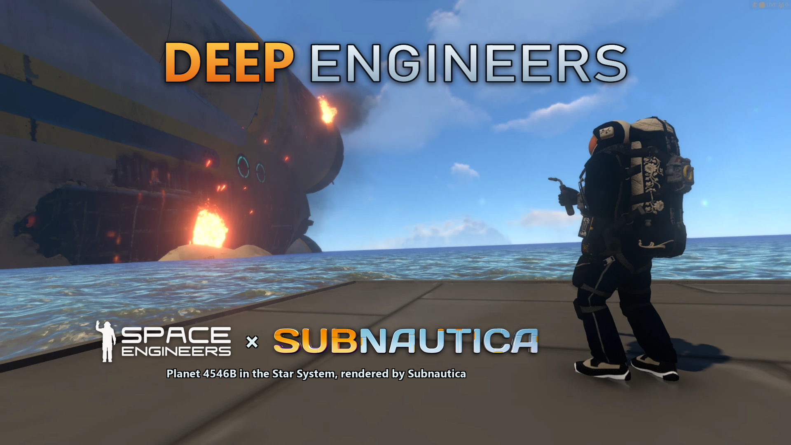

# DeepEngineers

DeepEngineers puts Subnautica's ocean planet, 4546B, into the Space Engineers Star System. Start a new game in Survival or Creative, drop in a capsule and splash down in Subnautica or any other planets.
From the moment you go under, the ocean is Subnautica's world: from the seabed to the creatures with your Space Engineers suit, tools, ships and HUD inside it. 

Both games run at once, Space Engineers is the game you play and Subnautica runs hidden and draws everything under the water. 

**Mine the shallows to get ressources, build a hull that survives the deep, catch a fish for food, and say hello to leviathans with a bunch of warheads**

## The guide

- [Install](docs/install.md): A one click-installer tutorial
- [Play](docs/play.md): How to play
- [Features](docs/features.md): What is actually in the game, and the roadmap
- [Q&A](docs/faq.md) Q&A 

## Requirements

| | |
|---|---|
| PC | Windows 10 or 11, 64-bit |
| Games | Space Engineers and Subnautica, both owned and installed through Steam on the same PC |
| Steam Workshop | Water Mod, Text HUD API & DeepEngineers Workshop Mod |
| Memory | 32 GB is recommended since i've tested with that, 16 GB is the bare minimum, i cannot tell you that it wont stutter/crash  | 
| Graphics | 4GB VRAM Minimum | - The mod was tested with a laptop with AMD Radeon 780M iGPU, runs smoothly
| Mode | single player for now |

## Status: Open beta

DeepEngineers is in Open beta. You can already play the mod but expect bugs, lags and other issues, the build changes every few days (when i have time), and **things can break**.

This is a fan-made project, the code of **the mod ONLY** is open source, nothing else (no decompiled games, no workshops files)
